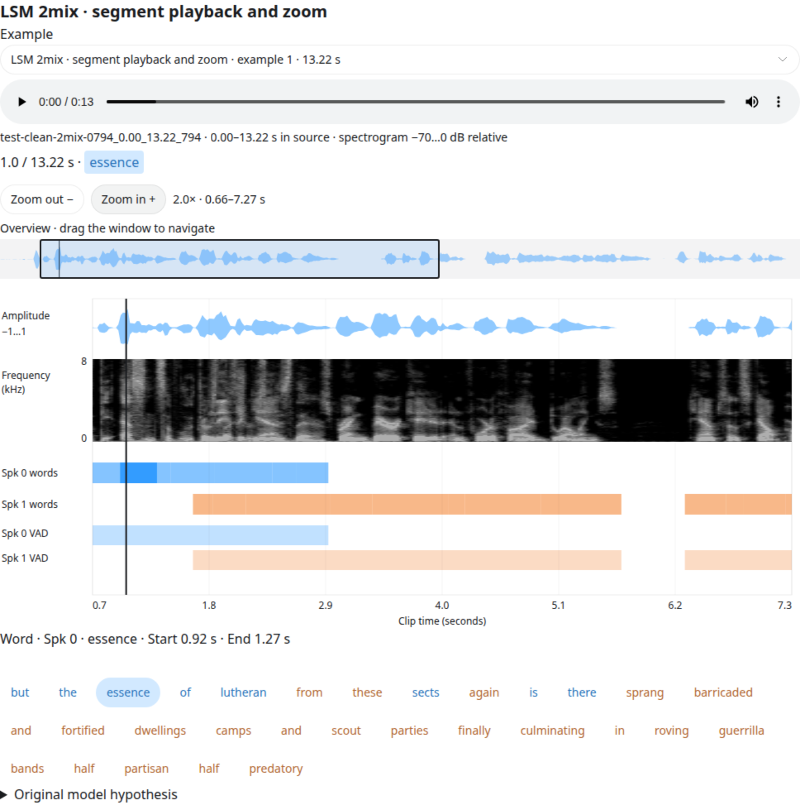
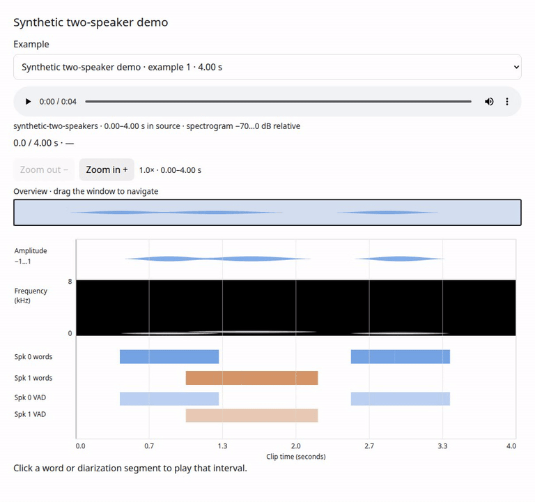

# Speech Timestamp Viewer for Codex & Your Browser

[](https://github.com/tango4j/speech-timestamp-viewer/actions/workflows/tests.yml)

[](pyproject.toml)
[](LICENSE)
[](#use-in-codex)

**Explore speech timestamps directly inside your Codex conversation—or in your regular browser.**

Play audio, click words, inspect speaker diarization and zoom through synchronized waveforms
and spectrograms in a portable, offline HTML player.
No GPU, NeMo installation, checkpoint, web server or JavaScript build tools required.

Inline display requires a supported Codex client. This is an independent viewer, not an official
OpenAI app or an installable Codex plugin. Browser use requires no Codex account.

- 🎧 **Click to listen** — play a word or diarization segment and stop at its end.
- 🔎 **Synchronized zoom** — waveform, spectrogram and timestamp tracks scale together.
- 🧭 **Navigate recordings** — drag the overview window or use keyboard controls.
- 🗣️ **Inspect multiple speakers** — color-coded words, simultaneous highlighting and VAD lanes.
- 📦 **Share offline** — self-contained HTML, excerpts and Codex-compatible fragments.

## Preview



**LSM 2mix at 2× zoom.** The overview covers half the recording. Click a word or diarization
bar to play its interval and inspect start/end times to two decimal places.

## Use in Codex

1. Clone this repository on the machine where Codex can access your audio and timestamp JSONL files.
2. Open the repository as a Codex project, or give Codex its absolute local path.
3. Paste this prompt, replacing the paths with your own:

```text
Read this repository's AGENTS.md and README.md. Set up the viewer's dependencies.
Use /path/to/predictions.jsonl and its audio files to build an interactive
timestamp viewer for 10 samples. Display the model hypothesis, not reference text.
Show synchronized audio, waveform, spectrogram, word timestamps and diarization,
with segment playback, zoom and overview navigation.
Save the output to a durable directory accessible to this conversation and
render the generated inline HTML fragments here. If this client cannot render
them inline, give me the standalone index.html file to open in my browser.
```

No predictions yet? Ask: **“Build the synthetic demo from this repository and show it inline.”**
The same Python/FFmpeg dependencies listed below are needed on the execution machine.
If audio paths are stored in a separate reference manifest, also provide its path; references
are used only for audio metadata. See [Codex integration](docs/codex.md) for details.

## Use in a regular browser

### 1. Install and generate a demo

Requires **Python 3.10+** and **FFmpeg with libmp3lame**. Install FFmpeg with
`sudo apt-get install ffmpeg` (Ubuntu), `brew install ffmpeg` (macOS), or
`conda install -c conda-forge ffmpeg`.

```bash
git clone https://github.com/tango4j/speech-timestamp-viewer.git
cd speech-timestamp-viewer
python -m venv .venv
source .venv/bin/activate
python -m pip install -e .
python examples/make_demo.py --output demo-data
speech-timestamp-viewer --predictions demo-data/predictions.jsonl --output output/demo
```

Open **`output/demo/index.html`** in a browser. The example uses synthetic tones and illustrative
labels, not recognized speech. No private recordings or model downloads are needed.

### 2. Open the standalone player

Double-click `output/demo/index.html`, or drag it into your browser. Open **`index.html`**, not
an `inline-*.html` fragment. No server or browser extension is required.

If you generated the viewer on a remote machine, download `index.html` to your computer first.
It embeds the selected audio and visualization data, so you do not need to copy the source audio.
Only share it with people authorized to access that data.

### 3. View your own predictions

```bash
speech-timestamp-viewer --predictions /path/to/predictions.jsonl --count 10 --seed 42 --output output/my-viewer
```

Open `output/my-viewer/index.html`. For separate audio manifests, add
`--references /path/to/reference.jsonl`. See [input formats](docs/input-formats.md) and
[path remapping and excerpts](docs/usage.md). Use a new output directory for each run.

### Controls in action



*Muted screen recording of the synthetic example. The generated HTML includes audio playback.*

## Controls

| Control | Action |
| --- | --- |
| Word text, word bar or VAD bar | Play that interval; show **Start / End** in seconds |
| Audio play / pause | Normal continuous playback after a segment finishes |
| Main timeline | Seek and cancel the segment playback limit |
| Zoom **+ / −** | Double / halve zoom on all tracks together |
| Overview window | Drag to pan; click outside it to recenter |
| Focused overview: **← / →** | Pan left / right |
| **Page Up / Down**, **Home / End** | Jump one window, or move to either edge |
| Original hypothesis | Expand the supplied text, including event/style tokens |

## Documentation

### Special-token display

Defaults are configurable through two lists:

```python
special_token_ignored = ["<spk:*>", "<sty:stt:*>", "<sty:end:*>"]
special_token_added = ["<ev:*>"]
```

Ignored tags remain visible as **light speaker-colored text without a box**. They have no
timestamp bars, click-to-play action or playback highlighting. Event tags remain interactive
like words when the predictions contain timestamps for them. The viewer never invents alignment.
Provide the original `hypothesis`, `pred_text` or `generation` to retain tags omitted from timestamp output.

Override the case-sensitive glob lists (quote patterns to prevent shell expansion):

```bash
speech-timestamp-viewer --predictions /path/to/predictions.jsonl --output output/custom \
  --special-token-ignored '<spk:*>' '<sty:*>' --special-token-added '<ev:*>'
```

An added pattern overrides an ignored pattern. Flags replace the defaults; a flag with no values
sets an empty list. Underscore aliases (`--special_token_ignored`, `--special_token_added`) also work.
The original hypothesis remains available verbatim in its expandable section. Text without a
matching timestamp—including text outside a selected excerpt—is passive, not assigned guessed times.

Supports generic JSONL and NeMo/SALM timestamp output. References can supply audio paths,
but **ground-truth text never replaces the hypothesis**. Choose a new output directory each run.

| Guide | Contents |
| --- | --- |
| [Input formats](docs/input-formats.md) | Schemas, speaker mapping, hypothesis selection |
| [Usage and navigation](docs/usage.md) | Path remapping, sample selection, excerpts and playback details |
| [Codex integration](docs/codex.md) | Inline fragments, output files and client requirements |
| [Development](docs/development.md) | Unit tests, browser checks and project structure |

## Scope and privacy

This is a **viewer**, not an ASR or alignment engine. Supplied timestamps are unchanged except
for excerpt clipping. Two-decimal formatting does not imply 10 ms accuracy. Zoom magnifies
the stored preview rather than recomputing acoustic features. Playback is not sample-accurate editing.

Generated players embed audio and hypothesis text: **treat them as sensitive as the original data**.
They require no CDNs or network requests. Do not commit private recordings, transcripts or generated players.

## License

The viewer code is [MIT licensed](LICENSE). Input audio and transcripts remain subject to their own permissions.
